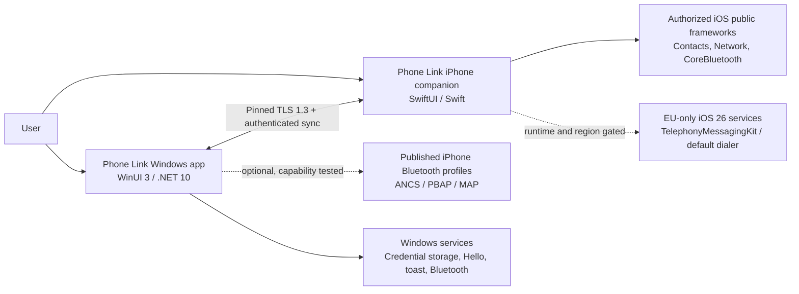
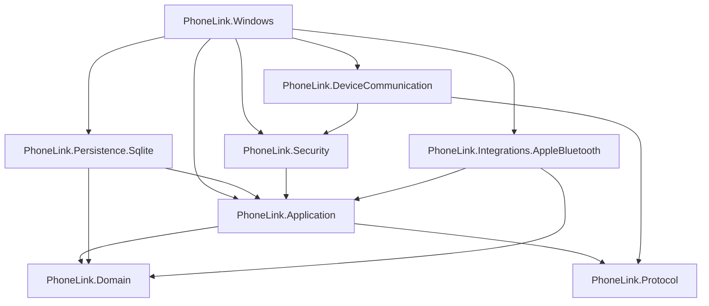
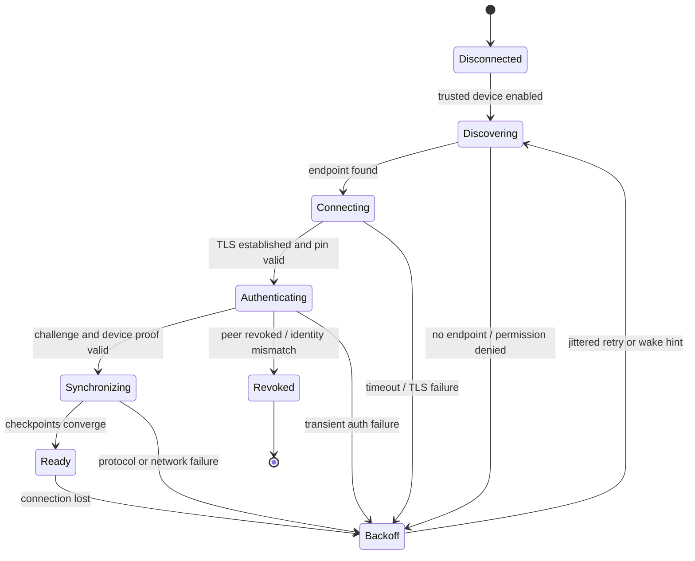
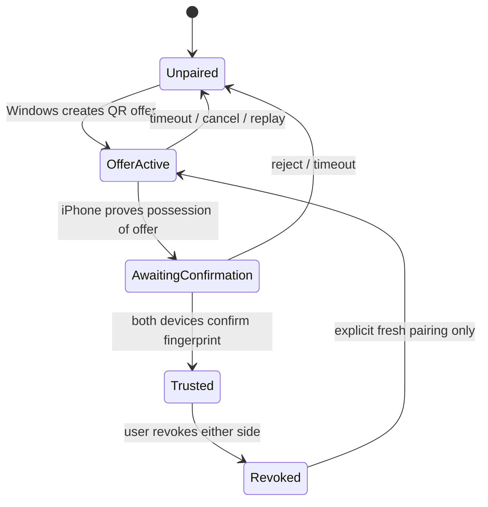

# Phase 2: system architecture

Status: **approved for implementation**  
Architecture version: **1.0**  
Date: **2026-08-12**

This architecture implements the feasibility boundary in [Phase 1](phase-1-feature-feasibility.md). It deliberately separates guaranteed companion-app features from optional Bluetooth accessory profiles.

## Technology decisions

| Area | Decision | Reason |
|---|---|---|
| Windows UI | C#, .NET 10 LTS, WinUI 3, packaged MSIX | Microsoft recommends WinUI 3/Windows App SDK for new native Windows apps. .NET 10 is LTS through November 2028. |
| Windows SDK | Stable Windows App SDK only; pin the exact package version | No preview/experimental API in the production path. At design time the current stable download is 2.3.1. |
| Windows minimum | Windows 11, x64 first; ARM64 after the core is stable | The intended product is modern and depends on Bluetooth LE, packaged desktop APIs, Windows Hello, and current servicing. |
| UI pattern | MVVM plus feature-oriented application services | Keeps XAML state separate from transport, database, and platform APIs. |
| Process model | Single packaged desktop process initially, .NET Generic Host for background services | Simplifies deployment while preserving service lifetimes, cancellation, logging, and dependency injection. A broker process can be split later without changing interfaces. |
| Local database | SQLite through `Microsoft.Data.Sqlite.Core`; SQLite3 Multiple Ciphers with authenticated ChaCha20-Poly1305 encryption at rest | SQLite is Microsoft-recommended for local Windows app data. The database key is never stored in the database. |
| iPhone app | Swift 6, SwiftUI, iOS 26 deployment target | SwiftUI is the native supported path. The production baseline avoids beta-only iOS 27 APIs and keeps the first implementation aligned with the iOS 26 SDK. |
| iPhone persistence | SwiftData for app-owned metadata/outbox; Keychain for secrets | Avoids sharing Windows storage internals and uses native data-protection behavior. |
| Primary transport | WebSocket over TLS 1.3 on local Wi-Fi | Bidirectional, interoperable, easy to frame, and appropriate for bulk sync. Windows hosts; iPhone connects. |
| Discovery | Bonjour/DNS-SD `_phonelink._tcp` plus last-known endpoint | Standard local discovery with explicit iOS Local Network permission. |
| Secondary transport | Custom BLE GATT for presence, wake hints, and small control frames | BLE is not used for bulk content. It is optional and capability-detected. |
| Apple Bluetooth profiles | Separate ANCS, PBAP, and MAP adapters | They have different permissions, lifetimes, and failure modes and cannot contaminate the guaranteed core. |
| Wire format | Strict UTF-8 JSON envelopes, binary attachment chunks, protocol version 1 | Native on .NET and Swift, inspectable during development, and dependency-light. |
| Time | UTC RFC 3339 timestamps plus per-origin monotonic sequence numbers | Wall clocks are display metadata, never the source of event ordering or deduplication. |
| IDs | Random UUID v4 generated by the event origin | Available on both platforms and safe for offline creation. |

References: [Windows app development](https://learn.microsoft.com/en-us/windows/apps/), [Windows App SDK downloads](https://learn.microsoft.com/en-us/windows/apps/windows-app-sdk/downloads), [.NET releases and support](https://learn.microsoft.com/en-us/dotnet/core/releases-and-support), [Windows SQLite guidance](https://learn.microsoft.com/en-us/windows/apps/develop/data-access/sqlite-data-access), and [Apple Xcode requirements](https://developer.apple.com/xcode/system-requirements/).

## System context



The Windows app never connects to an Apple Account and never talks to private Apple services. The iPhone companion owns every datum it sends through the core channel. Bluetooth profile data is tagged with its source and stricter retention rules.

## Repository and solution layout

```text
Phone Link/
  PhoneLink.slnx
  Directory.Build.props
  Directory.Packages.props
  global.json
  README.md
  docs/
  src/
    PhoneLink.Domain/
    PhoneLink.Protocol/
    PhoneLink.Application/
    PhoneLink.Security/
    PhoneLink.Persistence.Sqlite/
    PhoneLink.DeviceCommunication/
    PhoneLink.Integrations.AppleBluetooth/
    PhoneLink.Windows/
  tests/
    PhoneLink.Domain.Tests/
    PhoneLink.Protocol.Tests/
    PhoneLink.Application.Tests/
    PhoneLink.Persistence.Sqlite.Tests/
    PhoneLink.DeviceCommunication.Tests/
  ios/
    PhoneLinkCompanion.xcodeproj/
    PhoneLinkCompanion/
    PhoneLinkCore/
    PhoneLinkCoreTests/
  tools/
    protocol-fixtures/
```

### Windows project responsibilities

| Project | Responsibility | Must not contain |
|---|---|---|
| `PhoneLink.Domain` | Entities, value objects, enums, domain validation, feature-neutral rules | SQLite, WinUI, WinRT, sockets, JSON |
| `PhoneLink.Protocol` | Versioned wire envelopes, payload DTOs, JSON source generation, frame limits, protocol fixtures | UI, database implementation, platform secrets |
| `PhoneLink.Application` | Use cases, ports/interfaces, feature modules, authorization checks, mapping between domain and protocol | WinUI types, concrete database/socket/Bluetooth code |
| `PhoneLink.Security` | Windows identity keys, TLS certificate lifecycle, credential vault, hashing, lock service | Business features or XAML |
| `PhoneLink.Persistence.Sqlite` | Migrations, repositories, unit-of-work, encrypted database initialization, outbox/checkpoints | Bluetooth and UI |
| `PhoneLink.DeviceCommunication` | `IDeviceTransport`, Wi-Fi/TLS/WebSocket transport, DNS-SD, connection state machine, sync coordinator | XAML and feature-specific UI behavior |
| `PhoneLink.Integrations.AppleBluetooth` | Optional ANCS, PBAP, MAP adapters and capability probes | Companion protocol ownership or guaranteed-feature assumptions |
| `PhoneLink.Windows` | WinUI pages, view models, navigation, tray/window lifecycle, notifications, DI composition root | SQL strings, protocol parsing, raw cryptography |

### Application feature modules

`PhoneLink.Application` contains one folder/module per requested feature:

- `Pairing`
- `Devices`
- `Contacts`
- `Conversations`
- `Notifications`
- `Calling`
- `Settings`
- `Synchronization`
- `Attachments`
- `Locking`

Each module has commands/queries, handlers, validation, and interfaces. Features communicate through domain events or narrow interfaces—not by reaching into another module's repository.

### Dependency direction



Only the Windows composition root constructs concrete implementations. Core projects cannot reference `PhoneLink.Windows`.

## Core interfaces

These are architectural contracts. Phase 3 will create compile-checked definitions with cancellation, typed results, and nullable annotations.

```csharp
public interface IDeviceTransport : IAsyncDisposable
{
    TransportKind Kind { get; }
    TransportState State { get; }
    IAsyncEnumerable<TransportStateChanged> StateChanges(
        CancellationToken cancellationToken);
    Task ConnectAsync(DeviceConnectionContext context,
        CancellationToken cancellationToken);
    ValueTask SendAsync(ReadOnlyMemory<byte> frame,
        CancellationToken cancellationToken);
    IAsyncEnumerable<ReadOnlyMemory<byte>> ReceiveAsync(
        CancellationToken cancellationToken);
    Task DisconnectAsync(CancellationToken cancellationToken);
}

public interface ITrustedDeviceStore
{
    Task<TrustedDevice?> FindAsync(DeviceId id, CancellationToken cancellationToken);
    Task SaveAsync(TrustedDevice device, CancellationToken cancellationToken);
    Task RevokeAsync(DeviceId id, DateTimeOffset revokedAt,
        CancellationToken cancellationToken);
}

public interface ISecretStore
{
    Task StoreAsync(SecretName name, ReadOnlyMemory<byte> value,
        CancellationToken cancellationToken);
    Task<SecretBuffer?> RetrieveAsync(SecretName name,
        CancellationToken cancellationToken);
    Task DeleteAsync(SecretName name, CancellationToken cancellationToken);
}

public interface ISyncEventStore
{
    Task<AppendEventResult> AppendInboundAsync(SyncEvent syncEvent,
        CancellationToken cancellationToken);
    IAsyncEnumerable<SyncEvent> ReadOutboundAsync(DeviceId target,
        long afterSequence, int limit, CancellationToken cancellationToken);
    Task AdvanceCheckpointAsync(DeviceId source, long sequence,
        CancellationToken cancellationToken);
}
```

Bluetooth adapters expose normalized capability-specific interfaces such as `IAppleNotificationSource`, `IPhoneBookSource`, and `IMapMessageSource`. They do not implement `IDeviceTransport`; ANCS/PBAP/MAP are data integrations, not the trusted companion channel.

## Windows runtime components

| Component | Lifetime | Behavior |
|---|---|---|
| `ConnectionSupervisor` | Hosted singleton | Watches trusted devices/endpoints and runs one cancellable connection state machine per device. |
| `SyncCoordinator` | Per connection | Negotiates protocol/capabilities, exchanges checkpoints, replays the outbox, applies inbound events, and sends acknowledgements. |
| `PairingServer` | Short-lived | Exists only during a pairing offer; rejects expired/replayed session IDs and stops after success/cancel/timeout. |
| `DnsSdAdvertiser` | Hosted singleton | Advertises a non-sensitive service record. No secret or stable personal identifier appears in mDNS TXT data. |
| `BleWakePeripheral` | Optional hosted singleton | Advertises a product service and authenticated wake counter; never sends private content in advertisements. |
| `AppleProfileSupervisor` | Optional hosted singleton | Runs independent ANCS/PBAP/MAP probes after Windows Bluetooth pairing and user opt-in. |
| `DatabaseInitializer` | Startup gate | Retrieves the protected database key, opens the encrypted database, verifies migrations, and fails closed on key/integrity errors. |
| App lifecycle lock | UI lifecycle service | Applies the opt-in five-minute Windows Hello policy, covers data-bearing views, and clears app-owned ANCS notifications while locked. |
| `NotificationDispatcher` | Hosted singleton | Converts authorized events into Windows app notifications with privacy-aware previews. |

## iPhone companion modules

| Module | Responsibility |
|---|---|
| `Pairing` | QR parsing, camera permission, pairing transcript, two-device confirmation, trusted-computer management |
| `Security` | Keychain items, identity keys, server certificate pin, challenge signing, revocation |
| `Transport` | Bonjour browse, last-known endpoint, pinned TLS/WebSocket, BLE wake client, backoff |
| `Synchronization` | Persistent outbox, checkpoints, idempotent apply, capability negotiation |
| `Contacts` | Limited/full permission, fetch/minimize fields, change detection, tombstones |
| `AppMessaging` | App-owned encrypted cross-device conversations and attachments |
| `Notifications` | Companion-owned notifications/events only; never other apps' notification stores |
| `CarrierMessaging` | iOS 26 availability and EU/default-app checks around TelephonyMessagingKit |
| `Calling` | Confirmed system dial requests; optional app-owned VoIP; EU default-dialer adapter |
| `Settings` | Permission explanations, retention, trusted computers, diagnostics export |

The companion normally acts as the client because Windows can stay available while iOS cannot guarantee an always-running listener.

## Connection state machine



Backoff starts at 1 second, doubles to 60 seconds, applies full jitter, and resets after a stable ready period. A manual reconnect bypasses the current delay but not authentication.

## Device trust state machine



Revocation deletes application credentials immediately. OS-level Bluetooth pairing is presented as a separate cleanup step because apps cannot silently remove every system pairing relationship.

## Capability model

Capabilities are negotiated every authenticated session and stored only as last-observed state:

```text
core.contacts.read
core.contacts.avatar
core.app-messaging.text
core.attachments.transfer
core.device-status
core.notification-own-app
apple.ancs.observe
apple.ancs.actions
apple.pbap.contacts
apple.pbap.call-history
apple.map.observe
apple.map.send
apple.map.reply
ios26.eu.carrier-messaging.sms
ios26.eu.carrier-messaging.mms
ios26.eu.carrier-messaging.rcs
ios26.eu.default-dialer
```

UI commands are enabled from current capabilities, trust state, and permission state. The UI never infers capability from the OS version alone.

## Data flow examples

### Contact synchronization

1. The companion receives contact permission.
2. It fetches only configured fields and generates upsert/tombstone events with origin sequence numbers.
3. The outbox persists the events before transmission.
4. Windows transactionally records the event ID, updates contact projections, and advances its contiguous checkpoint.
5. Windows acknowledges the checkpoint; the companion prunes acknowledged outbox records according to retention policy.
6. If permission becomes limited or revoked, the companion emits permission-state plus tombstones for contacts no longer authorized.

### ANCS notification

1. Windows' optional ANCS adapter receives a session-scoped notification UID.
2. It lazily fetches allowed attributes and normalizes a transient view model.
3. The content is held in memory by default and removed when ANCS removes it or the session ends.
4. Only an explicit ANCS action exposed by iOS can be invoked.
5. No ANCS UID is written as a durable cross-session identifier.

### Attachment transfer

1. Sender emits metadata with size, media type, SHA-256, and random attachment ID.
2. Receiver checks policy, free space, size limit, and allowed media type before accepting.
3. Binary chunks include attachment ID, zero-based chunk index, and chunk hash.
4. Receiver writes to an app-private temporary file, verifies final size/hash, then atomically promotes it.
5. Cancellation or mismatch removes the temporary file.

## Error model

Every user-visible failure maps to a stable error code and a recoverability class:

- `permission.contacts.denied` — user action required
- `permission.local-network.denied` — user action required
- `pairing.offer.expired` — retryable by creating a new offer
- `pairing.identity.mismatch` — security failure; no automatic retry
- `transport.endpoint.unreachable` — transient
- `transport.tls.pin-mismatch` — security failure; revoke/re-pair
- `protocol.version.unsupported` — update required
- `protocol.frame.too-large` — peer/protocol violation
- `sync.sequence.gap` — recoverable by replay request
- `storage.key.unavailable` — unlock/recovery required
- `integration.ancs.unavailable` — optional capability unavailable
- `integration.map.profile-reserved` — optional capability unavailable

Logs contain codes, correlation IDs, durations, byte counts, and redacted device IDs. They never contain contact names, phone numbers, message bodies, notification text, tokens, keys, or QR payloads.

## Build and verification topology

- Windows projects build and test on this machine with .NET 10.
- The WinUI package is built from the command line after installing the current stable WinUI templates/workload.
- Protocol fixtures are language-neutral JSON files validated by .NET tests here and Swift tests on macOS.
- The native iPhone project can be authored here but must be compiled, signed, installed, and tested on a Mac with supported Xcode and a physical iPhone.
- Every phase ends with the strongest available automated tests plus explicit hardware checks where the platform requires them.

## Phase 2 implementation gates

Phase 3 may start when:

- project dependencies match the diagram;
- protocol v1 and its limits are frozen for the first implementation;
- database migrations and secret boundaries are specified;
- pairing and session authentication have a threat model;
- ANCS/PBAP/MAP remain optional adapters;
- no current design needs Apple Account credentials or private APIs.
