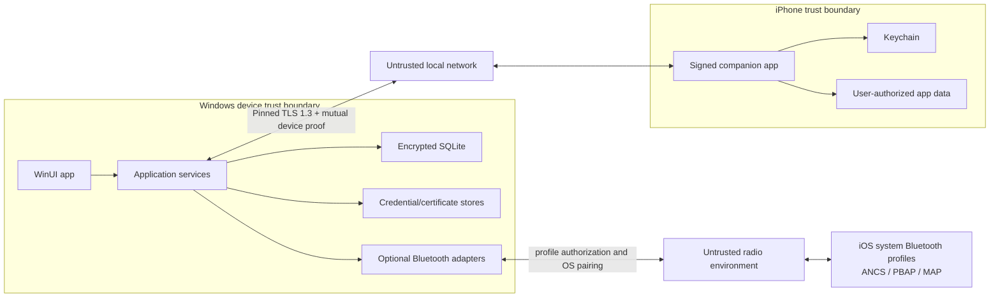

# Phone Link security and privacy threat model

Version: **1.0**  
Date: **2026-08-12**  
Applies to: Windows app, iPhone companion, local protocol v1, optional Apple Bluetooth adapters

Implementation checkpoint, October 20: this document includes design objectives, not a statement that every listed control has shipped. New contact sync uses per-PC protected state, authenticated checkpoint requests and subset reconciliation; narrowing permission scrubs the owning iPhone's fields and receipt payloads on the next successful foreground sync, not while the PC is offline. Revocation deletes companion trust before local outbox cleanup. New photo imports use immediate chunk-authenticated encrypted staging and two-pass bounded-memory export; old PLA1 imports remain readable. See [protocol](protocol-v1.md) and [attachment storage](attachment-storage.md) for implemented limits and failure behavior. General command-result persistence, quarantining/rate-limit policy, atomic projection-plus-receipt transactions, authenticated key rotation, and durable transfer resume remain separate unfinished controls; schema fields or this threat table do not prove implementation.

## Security objectives

1. Only explicitly paired devices can exchange private data.
2. Local-network observers cannot read or modify traffic.
3. A stale QR, captured packet, duplicated event, or old command cannot be replayed successfully.
4. Revocation blocks future access without requiring an Apple or Microsoft account.
5. Secrets are protected by platform stores and never persist in plaintext files, SQLite, logs, or diagnostics.
6. The app collects only the data required for enabled features and preserves the source/permission boundary.
7. Optional Bluetooth profile failures cannot weaken the companion channel.
8. A malformed or malicious paired peer cannot cause unbounded allocation, path traversal, SQL injection, or arbitrary command execution.

## Trust boundaries



The local network and radio are hostile. A paired peer is authenticated but still untrusted input. The operating systems and their secure stores are trusted; a fully compromised/rooted OS is outside the protection claim and must be disclosed as such.

## Assets

| Asset | Sensitivity | Protection |
|---|---|---|
| Device identity private keys | Critical | Keychain / Windows protected key store; non-exported where platform permits |
| TLS private key | Critical | Windows certificate/key store; never included in diagnostics |
| Database and attachment master keys | Critical | Current-user DPAPI (`DataProtectionProvider("LOCAL=user")`); the Windows Hello option gates the UI, not key unwrapping |
| One-time QR pairing secret | Critical, short-lived | Memory only, 120-second TTL, atomically single-use |
| Authorized contacts | High | Encrypted database, source/permission tags, retention controls |
| Messages and attachments | High | Pinned TLS in transit, encrypted database/files at rest, user deletion |
| Notification/call metadata | High | Strict source retention; ANCS memory-only by default |
| Device IDs/public keys/capabilities | Medium | Encrypted database; public keys are not secrets but are integrity-sensitive |
| Logs/audit metadata | Medium | Redaction, bounded retention, local storage |

## Threats and controls

| ID | Threat | Primary controls | Residual limitation |
|---|---|---|---|
| T01 | Attacker on LAN impersonates Windows during first pairing | TLS SPKI pin in physical QR, one-time HMAC secret, Windows identity signature, two-device comparison phrase | A person who can view and use the live QR before the user can attempt pairing; Windows shows the requesting device and requires confirmation. |
| T02 | QR photo reused later | 120-second expiry, random session ID/secret, atomic consume, session removed after success/cancel | Device clocks may differ; Windows is authoritative and allows only a small skew. |
| T03 | LAN MITM after pairing | TLS 1.3, stored SPKI pin, signed fresh session transcript | Certificate/key rotation requires an authenticated rotation flow or explicit re-pairing. |
| T04 | Stolen peer credential replays old session proof | Fresh 256-bit nonces, unique session ID, signatures bind both nonces/version/IDs | A stolen live private key permits impersonation until revocation; platform key protection reduces extraction risk. |
| T05 | Captured event or command replay | Unique IDs, per-origin sequences, immutable payload hash, transactional receipts, idempotent command result cache, expiry | Replaying an exact event consumes resources for validation but cannot repeat its effect. |
| T06 | Malicious paired peer sends huge frames | WebSocket/frame hard limits, streaming parsing, bounded arrays/strings, negotiated lower limits, cancellation and rate limits | Repeated violations disconnect and locally quarantine the peer pending user review. |
| T07 | Path traversal or dangerous attachment name | Receiver-generated random storage path, display-name sanitization, media/size policy, hash verification, app-private directory | Opening a valid but malicious file is still risky; use OS handlers only after explicit user action and preserve Mark-of-the-Web where applicable. |
| T08 | SQL injection | Parameterized commands only, repository boundary, no dynamic SQL from peer data, strict schema constraints | Developer-authored migration SQL remains privileged and is checksum reviewed. |
| T09 | Database copied from disk | SQLite3 Multiple Ciphers full-database authenticated encryption, protected random key, user ACL, attachment encryption | Data is accessible while the unlocked app legitimately has keys in memory. |
| T10 | Secrets leak through logs/crashes | Central redaction policy, structured allowlisted metadata, no bodies/names/numbers/tokens/QRs, secret types avoid `ToString` | OS memory dumps from a compromised/admin environment can capture process memory. |
| T11 | Lost/unattended PC exposes UI | Opt-in five-minute inactivity lock, Windows Hello verification, opaque lock overlay, ANCS notification clearing, and close-to-tray policy | Windows account compromise, screenshots taken before locking, or an already-unlocked process weaken protection. |
| T12 | Lost iPhone remains trusted | Revoke from Windows, delete peer public key, fail session authentication; provide erase-cached-data option | Revocation cannot reach an offline stolen device until it reconnects; data already cached there follows iOS protection. |
| T13 | Lost PC remains trusted by iPhone | Revoke in companion, delete Windows pin/key; optionally remove Windows Bluetooth pairing in iOS Settings | OS Bluetooth relationship removal may require explicit system Settings action. |
| T14 | Contact permission narrows or is revoked | Sync permission-state event, tombstone no-longer-authorized projections, stop future fetch, configurable local erase | iOS limited-contact APIs may not enumerate every removed authorization in one callback; companion performs reconciliation on next execution. |
| T15 | Companion tries to forward other apps' notifications | Architecture prohibits it; no API exists; code module handles only app-owned notifications | ANCS is a separate Windows accessory adapter and has session-only rules. |
| T16 | ANCS identifiers/content retained as durable history | ANCS adapter uses an in-memory session cache, clears on disconnect/session change, never writes raw UID | User may see only active/current-session notifications, by design. |
| T17 | Optional MAP/PBAP/ANCS adapter bypasses core trust | Separate Windows interfaces, Windows system pairing and iOS authorization, feature-level opt-in, source tags, no access to companion keys | Bluetooth profile security/availability is controlled partly by OS implementations. |
| T18 | Bluetooth spoofing/downgrade | Require authenticated OS pairing for protected characteristics/profiles, reject unencrypted access, show stable paired-device identity | Bluetooth stack vulnerabilities are OS/vendor responsibility; keep Windows/iOS updated. |
| T19 | mDNS leaks identity | Generic service type/instance, rotating non-personal instance label, no contact/device name or stable user ID in TXT records | Presence of a Phone Link service on the LAN is observable. |
| T20 | Device discovery redirected to attacker | Endpoint is only a candidate; TLS SPKI pin and device proof authenticate the actual peer | Attackers can cause connection failures but not trusted data exchange. |
| T21 | Clock manipulation changes ordering | Origin sequence/revision determines order; wall time is display/audit metadata | Display times can be wrong until user fixes device clocks. |
| T22 | Rollback to vulnerable protocol | Record highest successful version per peer and reject silent downgrade | Explicit reset/re-pair can permit an older compatible peer; UI warns when security requirements differ. |
| T23 | Dependency or build compromise | Locked package versions, restore lock file, checksums/signatures, stable release channels, CI tests, SBOM during packaging | No software supply chain is risk-free; security updates require maintained releases. |
| T24 | Diagnostic export exposes private data | Fixed schema of redacted fields, preview before export, no database/attachments/secrets, explicit destination picker | File destination security is controlled by user after export. |
| T25 | Local privileged user extracts process data | OS ACL/Hello and minimal secret lifetime | Local administrator/kernel compromise is outside the guarantee. |

## Pairing security requirements

- Pairing is never initiated solely by receiving a network request; Windows must have an active user-created offer.
- Only one client may consume an offer.
- Pairing UI displays the requesting device name, platform, and six-word comparison phrase on both devices.
- Both confirmations are required within the offer lifetime.
- Cancelling either side invalidates the offer immediately.
- A successful pairing stores peer public information only; no shared Apple/Microsoft credential exists.
- Pairing failure messages avoid revealing whether a particular device ID was previously trusted.
- After five invalid proof attempts in one offer, invalidate it immediately.

## Session and transport requirements

- TLS 1.3 only for protocol v1; no plaintext WebSocket and no certificate-validation bypass flag.
- Pin SPKI rather than the full certificate to permit renewal with the same key.
- Device identity keys are independent of TLS keys.
- Authentication must finish before capability or checkpoint data is accepted.
- Every session has one cancellation root; revocation cancels it immediately.
- Receive loops parse one bounded frame at a time and apply backpressure.
- Liveness pings contain no private payload.
- Network transition reconnects from a clean authenticated session; WebSocket state is never resumed unauthenticated.

## Authorization model

Authentication answers "which paired device is this?" Authorization is evaluated separately for every operation:

```text
allow = trusted device
    AND authenticated current session
    AND negotiated capability
    AND local feature enabled
    AND source permission currently granted
    AND command/event valid for current platform/region
    AND app lock state permits the operation
```

Examples:

- A trusted phone without `core.contacts.read` cannot send contact events.
- A `calling.request-system-dial.v1` command cannot bypass iPhone foreground confirmation outside the EU default-dialer path.
- MAP send is disabled unless the optional adapter probe succeeds and the user separately enables it.
- Revoked devices fail before any database projection or capability response.

## Secret lifecycle

| Secret | Creation | Storage | Rotation/deletion |
|---|---|---|---|
| Windows Ed25519 identity | First secure startup | Protected Windows store | Rotate only through authenticated update or reset; delete on full reset |
| Windows TLS key/certificate | First secure startup | Windows certificate/key store | Renew cert with same key where possible; key change requires authenticated pin update/re-pair |
| iPhone Ed25519 identity | First companion startup | Keychain | Rotate through authenticated update or reset; delete on app trust reset |
| Database key | First database creation | Protected Windows credential store | New database/reencryption workflow; delete first for cryptographic erase |
| Attachment master key | First attachment use | Protected Windows credential store | Rewrap per-file keys during rotation; delete on full erase |
| Pairing secret | Every offer | Memory only | Delete on consume, expiry, cancel, or app exit |

Secret buffers are zeroed/disposed where APIs allow. Code never converts raw secret bytes to ordinary strings except where a platform credential API requires Base64 text; such strings have the shortest possible lifetime and are never logged.

## Data minimization and privacy defaults

- Local-only communication; no cloud service is required.
- No telemetry in v1. Crash/diagnostic export is user-initiated.
- Contacts request limited access first and explain why full access is optional.
- Contact notes are never requested.
- Notification previews on the Windows lock screen are off by default.
- ANCS content is current-session memory only.
- App-owned notification retention defaults to 30 days; call history to 90 days.
- Attachments require an explicit send/receive feature and a 25 MiB default limit.
- Every retained record keeps its legitimate source so the UI can explain where it came from.
- Permission revocation stops collection immediately and offers deletion of cached data.
- The product never asks for or transmits an Apple Account password or verification code.

## Logging policy

Allowed fields:

- stable error/event code;
- timestamp and duration;
- correlation ID;
- truncated hash of device ID (diagnostic correlation only);
- transport kind and state;
- protocol/capability versions;
- counts and byte sizes;
- retry number and redacted OS error code.

Forbidden fields:

- contact/message/conversation/notification/call content;
- names, phone numbers, emails, filenames supplied by peers;
- endpoint query strings containing pairing data;
- full IP history in exported logs;
- tokens, private/public key material, certificate bodies, database keys;
- QR payloads, pairing secrets, signature/HMAC inputs;
- raw JSON frames.

Debug builds use the same redaction library. Tests include canary secrets and assert they never appear in captured logs.

## Revocation behavior

1. Mark the peer revoked in one transaction.
2. Cancel active connections and reject future handshakes.
3. Delete peer-specific authentication material from protected storage.
4. Remove endpoints and pending outbound deliveries.
5. Ask whether to retain or erase cached contacts/messages/files/history.
6. Explain how to remove the OS Bluetooth pairing if one exists.
7. Write a metadata-only audit event.

Re-pairing a revoked physical phone creates a fresh device ID and keys. Old credentials are never reactivated.

## Security verification plan

Automated tests:

- known-answer pairing HMAC/signature/comparison fixtures on .NET and Swift;
- expired, replayed, double-consumed, and malformed offers;
- TLS pin match/mismatch and identity-key mismatch;
- session proof replay across fresh nonces;
- event ID/sequence duplicate and collision behavior;
- strict JSON limits, duplicate property rejection, invalid UTF-8, deep nesting, unknown enums;
- attachment traversal names, oversize declarations, chunk/final hash failure, cancellation cleanup;
- SQL parameterization, constraints, wrong database key, migration rollback;
- secret/log canary redaction;
- revocation during pairing, authentication, sync, and attachment transfer;
- permission downgrade/tombstone behavior;
- protocol downgrade rejection.

Manual/hardware tests:

- QR shoulder-surf and competing scan behavior;
- Windows/iPhone lock, sleep, network change, Bluetooth toggle, and process termination;
- iOS limited contacts then revoke/expand/restrict;
- Windows Hello unavailable/cancel/failure paths;
- ANCS/PBAP/MAP permissions and session teardown on a physical iPhone;
- lost-device revocation from each side;
- installer upgrade/uninstall data choices.

Release gates:

- no critical/high threat without an implemented control and test;
- dependencies scanned and locked;
- MSIX signed for the intended distribution route;
- iOS entitlements match actual code and App Store disclosure;
- privacy manifest/permission strings match collected data;
- diagnostic export manually reviewed with populated private test data;
- no private API symbol or undocumented Apple service endpoint in binaries/configuration.

## Accepted limitations

- If Windows or iOS is fully compromised, this app cannot guarantee secrecy from that OS.
- Background reconnect timing is controlled partly by iOS and is best-effort.
- Bluetooth profiles inherit OS/accessory security and availability constraints.
- User-approved notification/message content displayed on Windows is visible to the Windows user while the app is unlocked.
- There is no recovery of encrypted local data after all protected keys are lost; this is preferable to a hidden recovery credential or cloud escrow in v1.
